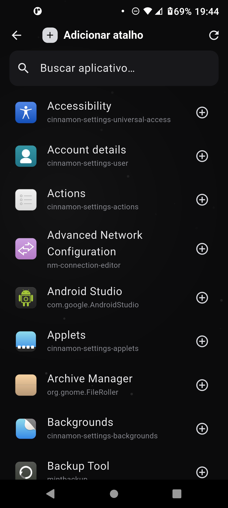
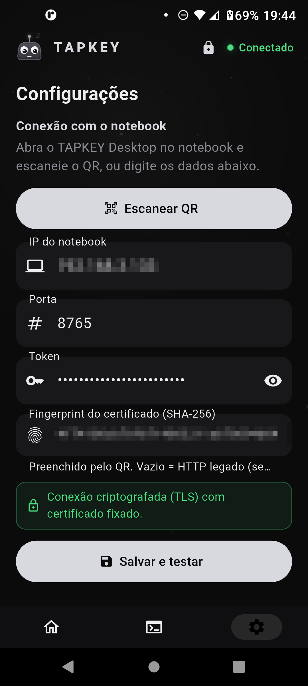
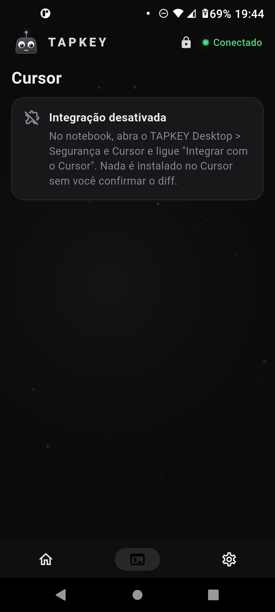
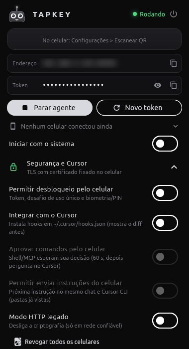
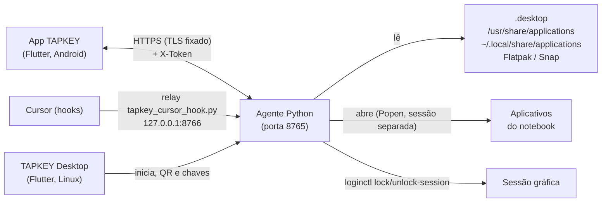

<div align="center">


# TAPKEY

### Seu notebook na palma da mão. Um toque, e abre.

Atalhos no celular que abrem aplicativos no seu notebook Linux, bloqueiam/desbloqueiam a tela e (opcionalmente) acompanham o Cursor, pelo Wi‑Fi, com conexão criptografada e fixada por QR, animações por toda parte e o **Tapi**, um mascote original que reage a cada toque.

[](https://flutter.dev)
[](https://dart.dev)
[](https://www.python.org)
[](https://linuxmint.com)
[](#celular-app-tapkey-android)
[](LICENSE)


<sub>GIF gravado no celular real (<code>adb screenrecord</code> → GIF): abertura com a ilha, Tapi passeando, lançamento de atalho, modo edição com arrastar, troca de abas e tela de adicionar.</sub>

</div>

---

## Download

<div align="center">

[-3DDC84?style=for-the-badge&logo=android&logoColor=white)](https://github.com/heliorosadoneto/TAPKEY/raw/main/releases/TAPKEY.apk)
[-A81D33?style=for-the-badge&logo=debian&logoColor=white)](https://github.com/heliorosadoneto/TAPKEY/raw/main/releases/tapkey-desktop_0.1.0_amd64.deb)
[-0E76A8?style=for-the-badge&logo=linux&logoColor=white)](https://github.com/heliorosadoneto/TAPKEY/raw/main/releases/TAPKEY-Desktop-x86_64.AppImage)
[-555555?style=for-the-badge&logo=linux&logoColor=white)](https://github.com/heliorosadoneto/TAPKEY/raw/main/releases/TAPKEY-Desktop-linux-x64.tar.gz)

</div>

Binários prontos em [`releases/`](releases/) (versão 0.4.0 do projeto; pacote 0.1.0). Nenhum IP ou token vem embutido: o pareamento é feito pelo QR do TAPKEY Desktop.

**Celular (Android 7+):** baixe o `TAPKEY.apk`, permita "instalar apps desconhecidos" para o navegador/gerenciador de arquivos e toque no arquivo. O APK é universal (arm64, armv7, x86_64) e assinado com a chave de release própria do projeto.

**Notebook (Linux x86_64):**

```bash
# .deb (Debian/Ubuntu/Mint)
sudo apt install ./tapkey-desktop_0.1.0_amd64.deb
tapkey-desktop

# AppImage
chmod +x TAPKEY-Desktop-x86_64.AppImage && ./TAPKEY-Desktop-x86_64.AppImage

# tar.gz portátil
tar xzf TAPKEY-Desktop-linux-x64.tar.gz && ./TAPKEY-Desktop/run.sh
```

AppImage e tar.gz precisam de `python3`, `openssl`, GTK 3 e `libayatana-appindicator3-1` no sistema (o .deb instala essas dependências).

**Verificar os arquivos** (`sha256sum -c SHA256SUMS` dentro de `releases/`):

```
2adf12ced7b4dcf60d98624f69fae1f482efebebee7384ce9be3cd8e31089299  TAPKEY.apk
d9ec99cda3739e2a84ac80fbef02e38010666ca88b2518b54d498f2942f03e9c  tapkey-desktop_0.1.0_amd64.deb
82a4de371d5282fee4b2ae3133e241615fdbbadc44f55b0c234a0f5243d7abe4  TAPKEY-Desktop-linux-x64.tar.gz
c8dabc87511f6c657e18ccf543a4a2860d36351f817db7aa620e32b6681ceb25  TAPKEY-Desktop-x86_64.AppImage
```

## Índice

- [Download](#download)
- [O que é](#o-que-é)
- [Galeria](#galeria)
- [Recursos](#recursos)
- [Como funciona](#como-funciona)
- [Requisitos](#requisitos)
- [Instalação](#instalação)
- [Pareamento (QR com TLS fixado)](#pareamento-qr-com-tls-fixado)
- [Bloquear e desbloquear pelo celular](#bloquear-e-desbloquear-pelo-celular)
- [Integração com o Cursor (opcional)](#integração-com-o-cursor-opcional-tudo-desligado-por-padrão)
- [API do agente](#api-do-agente)
- [Segurança](#segurança)
- [Arquivos e portas](#arquivos-e-portas)
- [Estrutura do projeto](#estrutura-do-projeto)
- [Compilar, executar e testar](#compilar-executar-e-testar)
- [Solução de problemas](#solução-de-problemas)
- [Limitações conhecidas](#limitações-conhecidas)
- [Roadmap](#roadmap)
- [Histórico de mudanças](#histórico-de-mudanças)
- [Licença e créditos](#licença-e-créditos)

## O que é

O TAPKEY tem três peças que conversam pela rede local:

| Peça | O que faz |
|---|---|
| **App do celular** (Flutter, Android) | Grade de atalhos, bloqueio/desbloqueio, aba Cursor, protetor de tela, mascote e animações |
| **Agente do notebook** (Python, só biblioteca padrão) | Lista os programas instalados, abre o que você tocar, bloqueia/desbloqueia a sessão e, se habilitado, fala com o Cursor |
| **TAPKEY Desktop** (Flutter, Linux) | Liga o agente, mostra o QR de pareamento, o token e as chaves de segurança; bandeja e início com o sistema |

Princípios: **sem nuvem** (tudo na sua rede), **seguro por padrão** (TLS com certificado fixado, token, lista fechada de aplicativos, recursos sensíveis desligados), **leve** (agente sem dependências) e **com personalidade**.

## Galeria

Capturas reais do celular (`adb screencap`) e do TAPKEY Desktop em execução, com dados de demonstração (token e certificado descartáveis, IP/QR desfocados).

### Celular

| Início | Ilha (evento) | Modo edição | Adicionar atalho |
|:--:|:--:|:--:|:--:|
|  |  |  |  |

| Cursor (sessões) | Aprovação de comando | Bloquear / Desbloquear | Configurações |
|:--:|:--:|:--:|:--:|
|  |  |  |  |

| Protetor de tela | Cursor desativado | Paisagem (tela cheia) |
|:--:|:--:|:--:|
|  |  |  |

### TAPKEY Desktop (notebook)

| Painel principal | "Segurança e Cursor" expandido |
|:--:|:--:|
|  |  |

<sub>As capturas de Início, Ilha, Edição, Adicionar, Configurações, Bloqueio, Protetor de tela e Cursor desativado foram tiradas no celular (IP e fingerprint desfocados em Configurações); Cursor e Aprovação (sessão simulada pelo relay de hooks) e Paisagem vêm de execuções anteriores (a paisagem, de <code>flutter test test/screenshots_test.dart</code> com dados de demonstração). No Desktop, o QR está pixelado e o endereço desfocado de propósito.</sub>

## Recursos

### Grade de favoritos
- Cartões **quadrados** (1:1) com o **ícone real** do aplicativo do notebook (o agente extrai e serve o PNG; há avatar de letra como alternativa).
- Em retrato, 3 colunas (2 em telas estreitas); em **paisagem**, a grade ocupa a tela toda (modo imersivo) e escolhe o número de colunas que dá os maiores cartões possíveis, com trilho lateral (Tapi, status, bloqueio e abas).
- Toque abre o aplicativo no notebook; **toque longo entra no modo edição**: os cartões balançam (jiggle), aparece um selo para remover, e você **arrasta para reordenar** (o cartão levanta com sombra, os vizinhos deslizam com mola, e ele assenta com elástico; rolagem automática nas bordas). Em edição, tocar num cartão abre a folha de opções (mover para o início/trás/frente, remover). *Concluir* ou o botão voltar saem do modo.
- Os favoritos ficam salvos no celular (`shared_preferences`).

### Lista de aplicativos do notebook e adicionar atalhos
- O agente lê os arquivos `.desktop` (`/usr/share/applications`, `~/.local/share/applications`, Flatpak e Snap), ignora entradas ocultas/`NoDisplay` e publica `{id, name, icon}`.
- Tela **Adicionar atalho**: busca por nome, lista com ícones, marcar/desmarcar favoritos; linhas animadas, ícone que gira ao alternar, destaque ao adicionar, e mensagem na ilha (no lugar de *snackbar*).
- O app só envia o **id**; a linha `Exec` nunca vem do celular.

### Tapi, o mascote


**Tapi** é um pequeno robô de corpo trapezoidal arredondado com uma **antena de ponta luminosa**, desenhado só com `CustomPainter`, molas e curvas (sem imagens nem Lottie). É um personagem **original** do projeto.

- **Motor de estados** com valores atual/alvo e suavização exponencial (transições sempre contínuas) e *keyframes* por propriedade;
- **olhos esféricos** (esclera, íris e brilho) que seguem o toque; piscadas aleatórias (2,2 a 5,4 s, às vezes duplas) e respiração;
- **squash & stretch** com curvas cúbicas/*back*; a **antena** é uma mola física (rigidez 60, amortecimento 9) que balança com os movimentos;
- **emoções**: feliz, amor (corações e rubor), surpreso, orgulhoso (estrelas), bocejo (z), piscadinha, olhos de coração/estrela, tontura (espiral + giro), preocupado, erro (tremida), concentrado, dormindo e **sonolento**;
- **ações**: pulinho, olhar em volta, espreguiçar, curioso (inclina a cabeça), "coucou" (aceno), giro com faíscas;
- **partículas** de corações, estrelas, faíscas e "z";
- **reage a eventos**: atalho aberto = pulo feliz + giro; notebook desconectado = preocupado; abrindo = concentrado; erro = tremida; aprovação do Cursor = susto; concluído = giro com faíscas;
- **toque simples** amassa; **toque longo** é carinho; toques seguidos o deixam tonto;
- **economia de bateria**: o relógio de animação para quando o Tapi fica parado por um tempo.

O mesmo Tapi aparece no cabeçalho do TAPKEY Desktop. O ícone do app (celular, desktop e `.deb`) é gerado por código a partir do próprio Tapi (`flutter test test/gen_icons_test.dart`).

### Animações e vida

- **Tapi no palco (Início):** um Tapi grande vive acima da grade e passeia (mola), inclina ao andar, **olha/vai até o cartão tocado**, pula e gira feliz ao lançar; **toques rápidos o deixam tonto**; fica **curioso** quando a lista rola; **sonolento** antes do protetor de tela; e acorda esticando.
- **Comportamentos ociosos** a cada poucos segundos: olhar em volta, pulinho, piscadinha, bocejo, espreguiçar, "coucou", corações e olhos de estrela com partículas.
- **Cartões:** entrada escalonada com mola; aperto com *squash & stretch* e solta elástica; **tilt 3D** e *parallax* do ícone seguindo o dedo; brilho radial no ponto tocado; ao lançar, **pulso + anel que se expande + partículas**.
- **Transições:** eixo compartilhado (fade-through com mola) entre telas e abas; `Hero` do botão "+" para *Adicionar atalho* e do ícone do cartão para a folha de opções; ícones que giram/pulam ao alternar (cadeado, abas, chips, favoritos).
- **Fundo vivo:** pontos monocromáticos à deriva e um brilho que respira, com **ondas onde você toca** (≈ 30 fps; pausa em segundo plano e durante o protetor de tela).
- **Conexão:** o ponto de status faz "sonar" (anel que se expande; ritmo rápido quando desconectado) e o texto troca com animação.
- **Tato (haptics)** nos principais toques: cartões, abas, reordenar, remover, ilha (erro pesado, sucesso leve, aviso médio), aprovações.
- Microinterações em *Configurações* (chips do protetor de tela com mola, mensagens na ilha).

### Ilha
Uma pílula no topo. Ela **nasce como uma bolinha com o Tapi** (mola com *overshoot*), a forma se **expande até o tamanho do conteúdo** (largura por mola, medida com `TextPainter` respeitando o tamanho de fonte do sistema), o texto entra **palavra por palavra (≈ 35 ms entre elas) com fade + desfoque**, e ao fechar recolhe de volta numa bolinha. Aparece ao abrir o app (o Tapi acena), ao abrir atalhos, ao mudar a conexão, ao bloquear/desbloquear, em eventos do Cursor e nas mensagens de Configurações/Adicionar.

### Protetor de tela
Depois de um tempo sem toques (**30 s, 1, 2, 5 min ou desligado**; padrão 1 min, em *Configurações*), o app entra em tela cheia imersiva com fundo preto (bom para OLED): o Tapi dorme flutuando com "z", derivando pela tela como o logo do DVD e se amassando ao bater nas bordas, com um relógio discreto. Mantém a tela acesa (`wakelock_plus`). Um toque faz a tela voltar com fade e o Tapi acorda (espreguiça e acena). Funciona em retrato e paisagem.

### Bloquear / Desbloquear
Veja a [seção própria](#bloquear-e-desbloquear-pelo-celular): bloqueio sempre disponível com o token; desbloqueio **opcional e desligado por padrão**, com biometria/PIN no celular e desafio de uso único.

### Pareamento seguro (QR com TLS fixado)
Veja [Pareamento](#pareamento-qr-com-tls-fixado): TLS com certificado autoassinado gerado por instalação, fingerprint SHA-256 no QR e fixado (*pinning*) pelo app, rotação/revogação de token.

### Integração com o Cursor
Opcional e desligada por padrão: status das sessões, aprovação de comandos, envio da próxima instrução e abrir pastas no Cursor. Veja [a seção](#integração-com-o-cursor-opcional-tudo-desligado-por-padrão), incluindo **limitações e itens não verificados**.

### TAPKEY Desktop
App do notebook (Flutter Linux, 380×700 por padrão): liga o agente ao abrir, **status** (Rodando/Parado), **QR de pareamento**, endereço, **token** (mostrar/copiar/gerar novo), lista de conexões recentes (inclui bloqueios/desbloqueios), **ícone na bandeja**, **iniciar com o sistema** e o painel **Segurança e Cursor** com as chaves: *Permitir desbloqueio pelo celular*, *Integrar com o Cursor* (diff do `hooks.json`), *Aprovar comandos pelo celular*, *Permitir enviar instruções do celular*, *Modo HTTP legado* e *Revogar todos os celulares*.

## Como funciona



1. O agente escaneia os `.desktop` e publica `/apps` com os ícones (`/icon/<id>`).
2. O app guarda os favoritos localmente e fala com o agente por HTTPS, verificando o fingerprint do certificado.
3. Ao tocar num cartão, o app envia `POST /launch {id}` e o agente abre o programa correspondente (processo separado).

## Requisitos

| Lado | Requisitos |
|---|---|
| Notebook | Linux Mint/Ubuntu (ou Debian), `python3` 3.10+, **`openssl`** (gera o certificado), sessão gráfica (X11/Wayland), mesma rede Wi‑Fi do celular |
| Celular | Android 7+ (testado no Android 11) |
| Desenvolvimento | Flutter 3.x com suporte a Linux desktop, `adb`, `dpkg-deb`, ImageMagick (`convert`) |
| Cursor (opcional) | Cursor com suporte a *hooks*; Cursor CLI (`agent`) para o modo CLI |

Testado em **Linux Mint 22.1 Cinnamon** + Android 11.

## Instalação

### Início rápido (3 passos)

1. **Instale o TAPKEY Desktop** no notebook:
   ```bash
   curl -fsSL https://raw.githubusercontent.com/heliorosadoneto/TAPKEY/main/install.sh | bash
   ```
2. **Abra o TAPKEY Desktop**: ele liga o agente e mostra um QR.
3. **No celular**, abra o app TAPKEY, vá em *Configurações > Escanear QR* e adicione seus atalhos.

### Notebook: TAPKEY Desktop (.deb)

O `install.sh` usa um `.deb` local, baixa o da última Release do GitHub ou compila a partir do código (se houver Flutter). Também dá para instalar manualmente:

```bash
sudo apt install ./tapkey-desktop_0.1.0_amd64.deb
```

O pacote instala o app em `/opt/tapkey-desktop`, o agente embutido (`agent.py`, `cursor_bridge.py`, `tapkey_cursor_hook.py`), o atalho no menu (com ícone) e o comando `tapkey-desktop`. Dependências: `python3`, `openssl`, `libgtk-3-0`, `libayatana-appindicator3-1`.

<details>
<summary><b>Gerar o .deb você mesmo</b></summary>

```bash
git clone https://github.com/heliorosadoneto/TAPKEY.git && cd TAPKEY
flutter config --enable-linux-desktop
./packaging/build_deb.sh 0.1.0     # gera dist/tapkey-desktop_0.1.0_amd64.deb
```

Dependências de build: `cmake ninja clang pkg-config libgtk-3-dev libayatana-appindicator3-dev imagemagick`.
Os binários não são versionados; ficam em `dist/` (ignorado pelo git) e em *Releases*.
</details>

### Notebook: apenas o agente (sem interface)

```bash
cd agent
python3 agent.py                  # mostra IP, porta, token, fingerprint e o link de pareamento
./start.sh                        # reinicia em segundo plano
```

<details>
<summary><b>Iniciar o agente com o sistema (systemd de usuário)</b></summary>

```bash
mkdir -p ~/.config/systemd/user
cp agent/meu-notebook-agent.service ~/.config/systemd/user/
systemctl --user daemon-reload
systemctl --user enable --now meu-notebook-agent.service
```
Ajuste o caminho do `agent.py` no `.service` se o projeto estiver em outro lugar.
</details>

### Celular: app TAPKEY (Android)

```bash
git clone https://github.com/heliorosadoneto/TAPKEY.git && cd TAPKEY
flutter pub get

# (opcional) valores padrão de conexão; o arquivo é ignorado pelo git
cp config.local.example.json config.local.json

# depuração sem fio: Opções do desenvolvedor > Depuração sem fio > Parear
adb pair IP:PORTA
adb connect IP:PORTA
flutter devices
./run.sh -d <id-do-dispositivo>   # usa config.local.json se existir
```

Sem `config.local.json` o app compila normalmente; basta parear pelo QR ou digitar IP, porta, token e fingerprint em *Configurações*.

## Pareamento (QR com TLS fixado)

1. Abra o **TAPKEY Desktop**. O QR contém `tapkey://pair?host=IP&port=8765&fp=<SHA-256 do certificado>&token=...&name=<notebook>`.
2. No app do celular: *Configurações > Escanear QR*. O app guarda o fingerprint e **só aceita o certificado com exatamente esse SHA-256** (nome, validade e emissor são ignorados; é o *pinning* que garante a identidade).
3. O topo do app fica verde ("Conectado"). A etiqueta *Conexão criptografada (TLS) com certificado fixado* aparece em Configurações.

- **Um token por aparelho:** ao escanear o QR, o celular gera um `device_id` aleatório e estável (guardado nele) e manda `X-Device-Id` + `X-Device-Name` (fabricante e modelo). O token do QR só serve para `POST /pair/register`, que devolve um **token só desse aparelho**; o app descarta o token do QR e passa a usar `X-Device-Token`. O agente guarda apenas o SHA‑256 em `devices.json` (0600).
- **Lista de celulares no Desktop:** agrupada por aparelho (nome, último IP, última vez visto, requisições), não mais por IP, então trocar de IP pelo DHCP não cria "outro celular". Entradas antigas (por IP) são unidas pelo mesmo IP/MAC e deixam de contar. "online" = falou com o agente nos últimos 30 s.
- **Revogar este aparelho:** botão ⛔ ao lado de cada celular. Apaga o token dele na hora (o agente relê `devices.json`); o celular passa a receber `401 {"revoked": true}`, avisa "Este aparelho foi revogado" e precisa escanear o QR de novo. Os outros continuam funcionando.
- **Trocar de celular / revogar:** *Novo token* (gera outro token) ou *Revogar todos os celulares* (apaga o certificado, gera token novo e reinicia o agente), ambos no Desktop.
- **Atualizando de uma versão antiga?** O agente agora usa HTTPS: escaneie o QR de novo.
- **Modo HTTP legado** (Desktop > Segurança e Cursor): volta ao HTTP sem criptografia, só para celulares antigos que não possam escanear o QR. Um aviso explica que tráfego e token ficam expostos.

<details>
<summary><b>Pareamento manual</b></summary>

Digite em *Configurações* o IP do notebook, a porta (`8765`), o token (mostrado no TAPKEY Desktop ou em `~/.config/tapkey/token`) e o fingerprint (em `~/.config/tapkey/tls/fingerprint`). Fingerprint vazio = HTTP legado.
</details>

## Bloquear e desbloquear pelo celular

- **Bloquear**: toque no cadeado no topo do app (ou no trilho, em paisagem) e em *Bloquear*. Funciona sempre que o token é válido (`loginctl lock-session`, reserva `cinnamon-screensaver-command --lock`).
- **Desbloquear** é **opcional e vem DESLIGADO**. Ative no TAPKEY Desktop em **"Permitir desbloqueio pelo celular"** (gravado em `~/.config/tapkey/settings.json`). Com a opção desligada o agente responde `403` e o app mostra "O desbloqueio pelo celular está desativado…".
- Ao desbloquear, o celular pede **biometria ou PIN/padrão/senha** (`local_auth`, `biometricOnly: false`) antes de falar com o notebook.
- Cada bloqueio/desbloqueio fica registrado na lista de conexões recentes do Desktop e em `~/.config/tapkey/events.log`.

**Como o desbloqueio é protegido** (além do TLS e do token):

1. o celular pede `GET /challenge` e recebe um *nonce* aleatório, **de uso único, válido por 20 s e preso ao IP** de quem pediu;
2. responde `POST /unlock {nonce, proof}` com `proof = HMAC‑SHA256(token, nonce)` (o token nunca viaja de novo dentro do corpo);
3. o agente compara em tempo constante, consome o nonce e **limita a 5 tentativas por minuto por IP** (`429` depois disso).

> **Limitação conhecida:** o desbloqueio usa `loginctl unlock-session` (com `cinnamon-screensaver-command --deactivate` como reserva). Testado e **funcionando no Linux Mint 22.1 Cinnamon**; em outros ambientes gráficos que não obedeçam ao sinal `Unlock` do logind, o *bloqueio* funciona mas o desbloqueio pode não ter efeito.

## Integração com o Cursor (opcional, tudo DESLIGADO por padrão)

> **Status:** implementada e testada com simulações, **não validada de ponta a ponta com o Cursor real**. O projeto encerrou esta frente neste estado. Leia as limitações abaixo antes de depender dela.

Tudo é ativado no **TAPKEY Desktop > Segurança e Cursor**. Sem ativar, `/cursor/*` responde `403`.

| Chave no Desktop | O que faz |
|---|---|
| **Integrar com o Cursor** | Instala o relay `tapkey_cursor_hook.py` em `~/.cursor/hooks.json` (mescla segura, com diff) |
| **Aprovar comandos pelo celular** | Comandos de shell/MCP esperam sua decisão no celular |
| **Permitir enviar instruções do celular** | Libera a fila de "próxima instrução" e o *Rodar no Cursor CLI* |
| **Modo HTTP legado** | Volta ao HTTP sem criptografia (veja Pareamento) |

### Como ativar os hooks (com segurança)

1. Desktop > *Segurança e Cursor* > **Integrar com o Cursor**. Um diálogo mostra o **diff** exato que será aplicado em `~/.cursor/hooks.json`; confirme. (Por padrão o arquivo real **não existe/não é tocado** até você ligar a chave.)
2. O instalador **faz backup** (`hooks.json.tapkey-backup-<data>`), **mescla** sem tocar nos seus hooks (os nossos são identificados por `tapkey_cursor_hook.py` no comando), grava de forma atômica e recusa-se a mexer se o JSON atual for inválido.
3. Desligar a chave **remove somente as entradas do TAPKEY** (e apaga o arquivo se foi criado por nós). Na linha de comando: `python3 agent/tapkey_cursor_hook.py status|diff|install|uninstall` (use `--home DIR` para testar numa cópia).
4. Eventos: `sessionStart`, `sessionEnd`, `beforeSubmitPrompt`, `preToolUse`, `postToolUse`, `postToolUseFailure`, `stop`, mais `beforeShellExecution`/`beforeMCPExecution` (aprovações).
5. Depois ligue **Aprovar comandos** e/ou **Permitir enviar instruções** conforme quiser.

O relay lê o JSON do Cursor, **corta campos em 2 KB**, envia ao agente por `127.0.0.1:8766` (segredo `~/.config/tapkey/hook_secret`, 0600) e **nunca bloqueia o Cursor**: timeouts curtos, `exit 0` e falha aberta. Se o agente estiver fora do ar ou ninguém estiver com o app aberto, o Cursor segue o fluxo normal.

### No celular (aba Cursor)

- **Sessões**: estado (trabalhando, pensando, aguardando, concluída), **só o nome da pasta** do projeto (nunca caminho completo nem texto do prompt) e a última ferramenta.
- **Aprovações**: cartão com o comando completo e contagem regressiva (≈ 60 s; depois devolve `ask` e o Cursor pergunta na tela). **Permitir** exige biometria/PIN; comandos com mais de 500 caracteres só podem ser **negados** no celular. O Tapi se assusta e a ilha avisa; ao concluir, giro com faíscas.
- **Enviar instrução**: *IDE*: entra na fila e é entregue pelo hook `stop` (`followup_message`) no **mesmo chat**; *CLI*: roda `agent -p --workspace <pasta> [--resume <chat>] -- "<texto>"` (nunca `--force`/`--yolo`) e transmite a saída para o celular. Pastas vêm só da lista de projetos vistos pelos hooks, máx. 4000 caracteres, 6 instruções/min, uma por vez; tudo registrado em `~/.config/tapkey/cursor.log`.
- **Abrir no Cursor**: `cursor <pasta>` para uma pasta da lista.
- Nunca se usa digitação simulada (`xdotool`).

### Testado × não verificado

| Testado | Como |
|---|---|
| TLS e fingerprint, token, HTTP simples recusado na porta TLS, modo legado | 28 testes Python (`agent/tests`) |
| Relay: falha aberta, corte de 2 KB, instalar/mesclar/backup/desinstalar/JSON inválido/arquivo criado por nós | testes Python + execução em cópia de `HOME` |
| Aprovações: permitir, negar, tempo esgotado, comando longo só negar, sem celular = resposta neutra | testes Python |
| Fila de instruções, entrega via `stop`, limites, allowlist, CLI **sem `--force`** (binário falso) | testes Python |
| Fluxo no celular real: pareamento por QR, aba Cursor via SSE, folha de aprovação, "Negar" devolvendo o JSON ao relay | eventos simulados pelo relay contra o agente real |

**Não verificado:** o comportamento real do Cursor IDE com os hooks (saídas neutras para `preToolUse` etc.); se o Cursor ainda pergunta por conta própria depois de "Permitir" no celular (enviamos permissão neutra); o `agent -p --resume <chat>` do Cursor CLI (o CLI está instalado, mas **não autenticado** no ambiente de desenvolvimento, então não foi executado de verdade).

### Limitações
- A instrução "IDE" só é entregue quando o próximo `stop` do Cursor disparar; se o chat estiver parado, use o modo CLI.
- Aprovações exigem o app aberto em primeiro plano (não há *push*).
- Celulares pareados antes do TLS precisam escanear o QR de novo.

## API do agente

Todas as rotas exigem HTTPS (certificado autoassinado, fingerprint fixado pelo app) e as credenciais do aparelho: `X-Device-Id`, `X-Device-Token` (e `X-Device-Name`). O token do QR (`X-Token`) só vale para `POST /pair/register` e `GET /ping`. Requisições de IP público (ou, no modo padrão, de fora da rede Wi‑Fi/Ethernet local) recebem `403`.

| Método | Rota | Descrição |
|---|---|---|
| `POST` | `/pair/register` | Com `X-Token` (do QR) + `X-Device-Id`/`X-Device-Name`: devolve `{device_token}` só deste aparelho |
| `GET` | `/ping` | Verifica se o agente está no ar |
| `GET` | `/apps` | Lista `[{id, name, icon}]` dos aplicativos instalados |
| `GET` | `/icon/<id>` | Ícone do aplicativo em PNG (404 se não houver) |
| `POST` | `/launch` | Abre o aplicativo: corpo `{"id": "firefox"}` |
| `GET` | `/session` | `{locked, unlock_allowed}`: estado da sessão do notebook |
| `POST` | `/lock` | Bloqueia a tela |
| `GET` | `/challenge` | Nonce de uso único (20 s) para o desbloqueio |
| `POST` | `/unlock` | Desbloqueia: `{nonce, proof}`; `403` se desativado, `429` se exceder 5/min, `400` se o desafio for inválido |
| `GET` | `/cursor/state` | Sessões, projetos, aprovações e fila (`403` se a integração estiver desligada) |
| `GET` | `/cursor/events` | SSE: `state`, `notice`, `cli`, `ping` |
| `POST` | `/cursor/approval` | `{id, decision: "allow"\|"deny"}` |
| `POST` | `/cursor/instruction` | `{text, mode: "ide"\|"cli", session_id, workspace_id}` (`403` se desativado, `429` limite) |
| `POST` | `/cursor/instruction/cancel` · `/cursor/cli/cancel` | Cancela item da fila / execução do CLI |
| `POST` | `/cursor/open` | `{workspace_id}`: abre a pasta no Cursor |

```bash
# certificado autoassinado: confira o fingerprint (SHA-256) do QR antes de usar -k
# 1) registra um "aparelho" de teste e guarda o token dele
DT=$(curl -sk -X POST -H "X-Token: $(cat ~/.config/tapkey/token)" -H "X-Device-Id: meu-curl-0001" \
     -H "X-Device-Name: curl" https://IP:8765/pair/register | python3 -c 'import sys,json;print(json.load(sys.stdin)["device_token"])')
# 2) usa as credenciais do aparelho
curl -k -H "X-Device-Id: meu-curl-0001" -H "X-Device-Token: $DT" https://IP:8765/apps
```

Rotas locais do relay (somente `127.0.0.1:8766`, nunca expostas na rede): `POST /hook` (cabeçalho `X-Hook-Secret`) e `GET /status` (sem segredo; usado pelo Desktop para saber se o agente está de pé).

## Segurança

| Camada | Proteção |
|---|---|
| **Transporte** | TLS com certificado autoassinado EC P‑256 por instalação (`~/.config/tapkey/tls/`, chave 0600). O **SHA‑256 vai no QR** e o app o **fixa**: outro certificado = conexão recusada. Sem fingerprint, o app só fala HTTP se o *modo legado* estiver ligado |
| **Autenticação** | Token do QR (`~/.config/tapkey/token`, 0600) só para parear; depois, **token por aparelho** (só o hash SHA‑256 fica em `devices.json`, 0600). *Revogar este aparelho*, *Novo token* e *Revogar todos os celulares* no Desktop |
| **O que pode ser aberto** | Somente IDs dos `.desktop` escaneados; a linha `Exec` nunca vem do celular; processos em sessão separada |
| **Desbloqueio** | Desligado por padrão; desafio de uso único (HMAC com a chave do aparelho), preso ao aparelho, 20 s, 5 tentativas/min; biometria/PIN no celular; tudo registrado |
| **Cursor** | Tudo desligado por padrão; relay local autenticado por segredo; sem caminhos absolutos nem texto de prompt no celular; "Permitir" exige biometria/PIN; comandos longos só podem ser negados; instruções limitadas e auditadas; nunca `--force`/`--yolo`; nunca `xdotool` |
| **Rede** | O agente escuta **só nos IPs privados das interfaces Wi‑Fi/Ethernet** (exclui `tun`/`tap`/`wg`/VPN/`tailscale`/`docker`/pontes de VM e interfaces ponto a ponto) e refaz o bind sozinho quando o IP muda (verifica a cada 5 s). Rejeita origem de IP público e, no modo padrão, de fora das redes dessas interfaces. Opção avançada *Escutar em todas as interfaces* (desligada; `listen_all`) volta ao `0.0.0.0`, ainda só para IPs privados. O relay (`8766`) escuta **apenas em loopback**. Com `ufw`, libere `8765/tcp` só para a sua rede |
| **Repositório** | Nada secreto versionado: IP, token e fingerprint reais ficam em `config.local.json` (ignorado pelo git) |

**Ameaças fora do escopo:** alguém com o celular desbloqueado e o app aberto pode abrir seus atalhos (o desbloqueio do notebook ainda pede biometria/PIN); malware já rodando como seu usuário no notebook lê os arquivos de `~/.config/tapkey`. Use em Wi‑Fi confiável.

## Arquivos e portas

| Porta | Uso |
|---|---|
| `8765/tcp` | Agente (HTTPS; HTTP só no modo legado) |
| `8766/tcp` (loopback) | Relay de hooks do Cursor e `/status` |

Em `~/.config/tapkey/`: `token`, `tls/{cert.pem,key.pem,fingerprint}`, `devices.json` (aparelhos pareados; só hashes dos tokens), `settings.json` (`allow_unlock`, `legacy_http`, `listen_all`, `cursor_integration`, `cursor_approvals`, `allow_instructions`, todos `false` por padrão), `hook_secret`, `hook.json`, `workspaces.json` (pastas vistas pelos hooks), `clients.json`, `events.log`, `cursor.log`, `icon_cache/`, `hooks/` e `cursor_hooks_state.json` (só se você instalar os hooks).

## Estrutura do projeto

```text
TAPKEY/
├── lib/                    # app do celular (Flutter)
│   ├── screens/            # início, adicionar atalho, configurações, leitor de QR, Cursor
│   ├── widgets/            # cartão animado, cabeçalho, Tapi (mascote e palco), ilha, fundo vivo,
│   │                       # protetor de tela, painel de bloqueio, folha de aprovação
│   ├── pinning.dart        # TLS com fingerprint fixado (HttpOverrides)
│   ├── cursor.dart         # cliente SSE e modelos da aba Cursor
│   ├── config.dart         # padrões de conexão (sem segredos)
│   └── state.dart          # favoritos, conexão e chamadas ao agente
├── desktop/                # TAPKEY Desktop (Flutter Linux)
├── agent/                  # agente Python
│   ├── agent.py            # servidor HTTPS, apps, lock/unlock, rotas do Cursor
│   ├── cursor_bridge.py    # estado das sessões, aprovações, fila, CLI
│   ├── tapkey_cursor_hook.py  # relay dos hooks e instalador seguro do hooks.json
│   └── tests/              # 28 testes
├── packaging/              # build_deb.sh, postinst, prerm, atalho .desktop
├── assets/icon/            # ícone gerado por código (Tapi)
├── test/                   # gerador de ícones, poses e capturas de tela
├── docs/                   # logo, demo.gif e capturas de tela
├── install.sh              # instalação em uma linha
├── CHANGELOG.md
└── config.local.example.json
```

## Compilar, executar e testar

```bash
# agente
python3 -W ignore -m unittest discover -s agent/tests    # 28 testes (TLS, token, hooks, aprovações, instruções, CLI, relay)

# app do celular
flutter pub get
flutter analyze
flutter test                                             # ícones, poses e capturas (dados de demonstração)
flutter build apk --release --dart-define-from-file=config.local.json
adb install -r build/app/outputs/flutter-apk/app-release.apk

# desktop e .deb
(cd desktop && flutter analyze && flutter build linux --release)
./packaging/build_deb.sh 0.1.0
```

Capturas do Desktop sem expor nada: rode com `HOME=/tmp/demo TAPKEY_PORT=18765` (instância descartável) e, para abrir o painel de segurança já expandido (sem QR), `TAPKEY_EXPAND_SECURITY=1`.

## Solução de problemas

| Sintoma | O que fazer |
|---|---|
| App mostra **Desconectado** | Celular e notebook na mesma rede? Agente rodando (Desktop "Rodando")? Firewall: `sudo ufw allow from <sua-rede> to any port 8765 proto tcp` |
| Conecta e depois **falha o handshake/certificado** | O certificado mudou (reinstalação, *Revogar todos os celulares*). Escaneie o QR de novo para fixar o novo fingerprint |
| "Token inválido" | Use o token atual do Desktop (ou escaneie o QR de novo depois de *Novo token*) |
| Ícones não aparecem | O agente serve PNGs; apps só com ícones SVG/temas podem cair no avatar de letra. Verifique `~/.config/tapkey/icon_cache` |
| Agente não sobe / erro de certificado | Instale `openssl` (`sudo apt install openssl`) e reinicie o Desktop |
| **Bloquear** funciona mas **Desbloquear** não | Ative "Permitir desbloqueio pelo celular" no Desktop; fora do Cinnamon o logind pode ignorar o sinal de desbloqueio |
| Aba Cursor diz "integração desativada" | Ligue **Integrar com o Cursor** no Desktop (e reinicie o chat do Cursor se ele já estava aberto) |
| Aprovações não aparecem | Ligue **Aprovar comandos**, mantenha o app em primeiro plano e confira `~/.config/tapkey/cursor.log` |
| Instrução "IDE" não chega | Só entrega no próximo `stop` do Cursor; use o modo CLI (precisa do `agent` autenticado) |
| Celular antigo sem câmera/QR | Use pareamento manual; como último recurso, *Modo HTTP legado* (inseguro) |
| Texto da ilha cortado | Fontes muito grandes do sistema: a ilha mede o texto com a escala do sistema; abra um issue se ainda cortar |
| `adb connect` falha | Em *Depuração sem fio*, use `adb pair IP:PORTA` com o código e depois `adb connect` na porta mostrada; `adb mdns services` lista as portas atuais |

Logs úteis: `~/.config/tapkey/events.log` (bloqueios/desbloqueios), `~/.config/tapkey/cursor.log` (integração) e a saída do agente (`/tmp/meu_notebook_agent.log` quando iniciado por `start.sh`).

## Limitações conhecidas

- **Só Android** no celular e **só Linux** no notebook (testado em Linux Mint 22.1 Cinnamon); um notebook por celular.
- Desbloqueio dependente do `logind`/ambiente gráfico (veja acima).
- Os aplicativos vêm dos `.desktop`; scripts e comandos livres não são suportados de propósito.
- Integração com o Cursor: itens **não verificados** listados acima; instrução "IDE" depende do próximo `stop`; aprovações sem *push*.
- Certificado autoassinado por instalação: não há renovação automática (validade 10 anos); *Revogar* gera outro e exige novo pareamento.
- A animação foi avaliada pelas gravações do celular, sem medição de quadros por segundo.

## Roadmap

- [x] Grade de favoritos, lista de apps do notebook e ícones
- [x] Paisagem em tela cheia e mascote animado
- [x] Pareamento por QR e TAPKEY Desktop com bandeja
- [x] Bloquear e desbloquear a tela pelo celular
- [x] Protetor de tela, ilha e mascote Tapi
- [x] HTTPS com certificado autoassinado e *pinning* pelo QR
- [x] Integração opcional com o Cursor (hooks, aprovações, instruções)
- [x] Pacote de animações (Tapi no palco, ilha com morph, edição por arrastar, fundo vivo)
- [ ] Vários notebooks (aba Dispositivos)
- [ ] Ações além de abrir apps (volume, mídia)
- [ ] Pasta/grupos de atalhos e temas
- [ ] Validar a integração com o Cursor de ponta a ponta (hooks reais e CLI autenticado)

## Histórico de mudanças

Veja o [CHANGELOG.md](CHANGELOG.md).

## Licença e créditos

Distribuído sob a licença [MIT](LICENSE).

- **Tapi** é um personagem **original** deste projeto, desenhado em código.
- O app **Coucou** serviu apenas de **inspiração de design** (ideias de ilha, animação e integração com o Cursor). **Nenhum código, arte ou marca de terceiros foi copiado**; todo o código e todos os desenhos são originais.
- Construído com [Flutter](https://flutter.dev), [flutter_animate](https://pub.dev/packages/flutter_animate), `local_auth`, `qr_flutter`, `mobile_scanner`, `wakelock_plus` e Python (biblioteca padrão).

## Autor

**Hélio Rosado Neto**: [@heliorosadoneto](https://github.com/heliorosadoneto)
