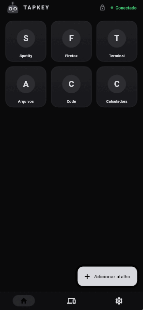
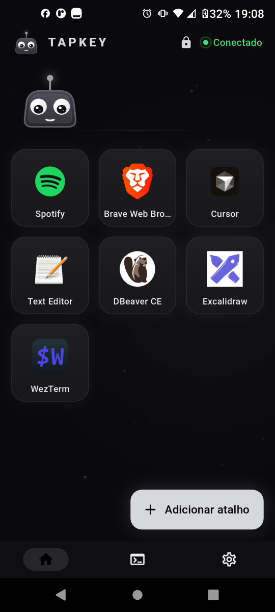
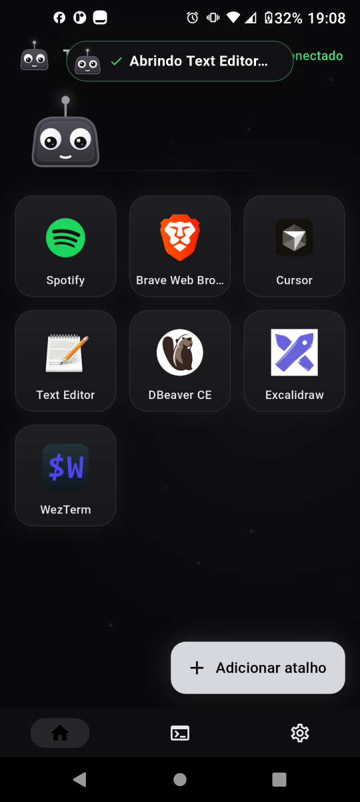
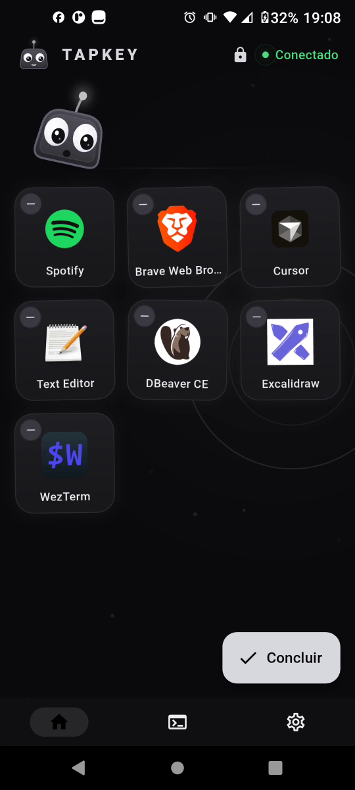
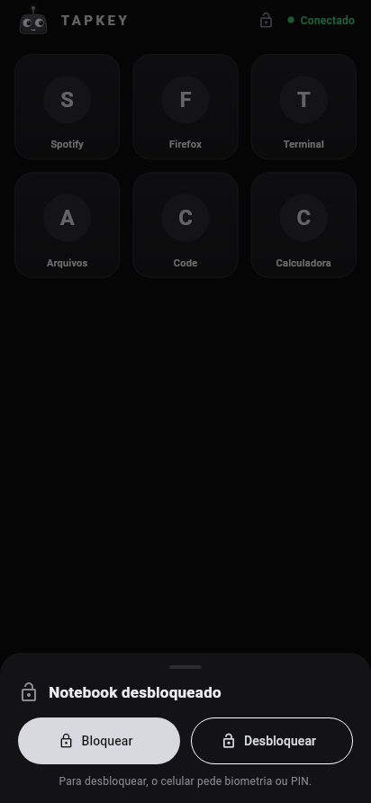
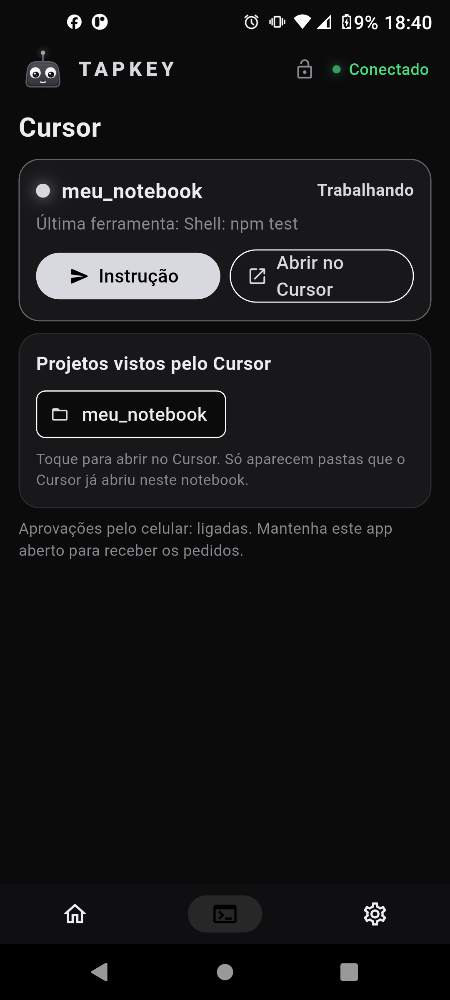
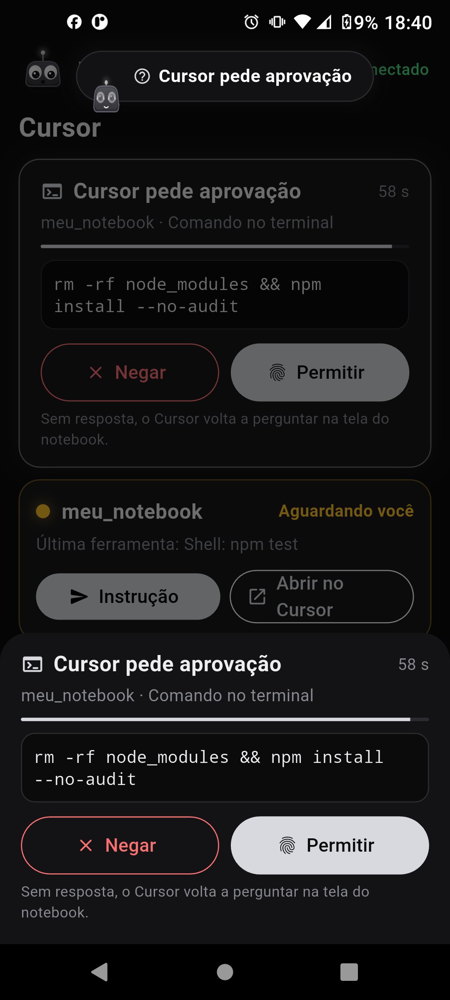
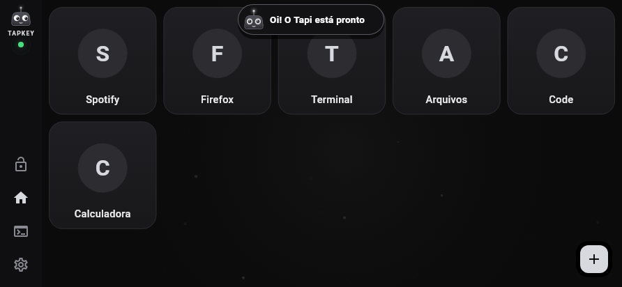
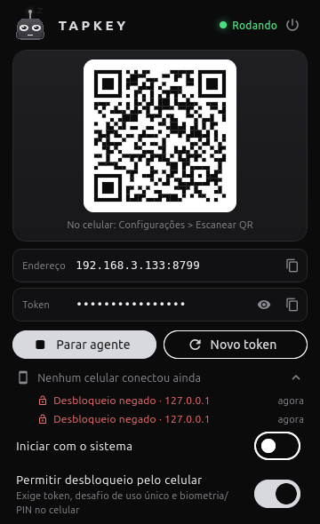
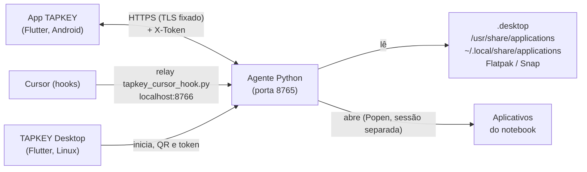

<div align="center">


# TAPKEY

### Seu notebook na palma da mão. Um toque, e abre.

Atalhos no celular que abrem aplicativos no seu notebook Linux (e bloqueiam ou desbloqueiam a tela), pelo Wi‑Fi, com animações fluidas e o **Tapi**, um mascote que reage a cada toque.

[](https://flutter.dev)
[](https://dart.dev)
[](https://www.python.org)
[](https://linuxmint.com)
[](#-instalação)
[](LICENSE)



</div>

<table align="center">
  <tr>
    <td align="center"><b>Retrato</b><br></td>
    <td align="center"><b>Ilha (evento)</b><br></td>
    <td align="center"><b>Modo edição</b><br></td>
    <td align="center"><b>Bloquear / Desbloquear</b><br></td>
    <td align="center"><b>Protetor de tela</b><br></td>
  </tr>
  <tr>
    <td align="center"><b>Cursor (sessões)</b><br></td>
    <td align="center"><b>Aprovação</b><br></td>
    <td colspan="2" align="center"><b>Paisagem (tela cheia)</b><br></td>
  </tr>
  <tr>
    <td align="center"><b>TAPKEY Desktop</b><br></td>
  </tr>
</table>

<sub>O GIF e as capturas de Início, Ilha, Edição, Cursor e Aprovação foram gravados no celular real (<code>adb screenrecord</code> → GIF). Paisagem, Bloqueio e Protetor de tela vêm de <code>flutter test test/screenshots_test.dart</code> (dados de demonstração).</sub>

---

## Por que TAPKEY?

- **Zero atrito**: o app do celular lista os programas instalados no notebook; você escolhe os favoritos e toca para abrir.
- **Sem nuvem**: tudo roda na sua rede local. Nenhum servidor de terceiros, nenhuma conta.
- **Seguro por padrão**: o notebook só abre aplicativos da lista de `.desktop`, nunca comandos arbitrários, e exige um token.
- **Leve**: agente em Python com biblioteca padrão e um app desktop compacto na bandeja.
- **Com personalidade**: tema escuro minimalista, animações em mola e um mascote que acompanha o seu dedo.

## Destaques

| | |
|---|---|
| **Grade de favoritos** | Cartões quadrados com ícone real do aplicativo; toque longo entra no modo edição (balançam), arraste para reordenar, selo para remover |
| **Lista do notebook** | O agente lê os `.desktop` (sistema, usuário, Flatpak e Snap) e envia nome e ícone |
| **Pareamento por QR** | Escaneie o QR do TAPKEY Desktop; IP, porta e token são preenchidos sozinhos |
| **Paisagem em tela cheia** | Grade ocupa toda a tela, cartões sempre quadrados e responsivos |
| **Tema minimalista** | Grafite com um único acento prata, brilho sutil só no acento |
| **Bloquear / Desbloquear** | Bloqueie o notebook pelo celular; desbloqueio opcional, com biometria/PIN, desafio de uso único e limite de tentativas |
| **Protetor de tela** | Após inatividade (30 s a 5 min), o Tapi dorme num fundo preto (OLED) e quica como o logo do DVD |
| **Ilha** | Pílula no topo com mola mostra eventos ("Abrindo Spotify…", "Notebook desconectado", "Bloqueado") |
| **Cursor no celular** *(opcional)* | Acompanhe sessões do Cursor, aprove/negue comandos (Permitir exige biometria/PIN) e envie a próxima instrução |
| **Transporte seguro** | TLS com certificado autoassinado por instalação, com *fingerprint* fixado no celular via QR |
| **Animação por toda parte** | Tapi passeia na Início e reage aos toques, ilha que "nasce" e se transforma, cartões com tilt/ondas/partículas, fundo vivo e tato |
| **Tapi, o mascote** | Desenhado em código (`CustomPainter`), personagem original com antena, emoções e partículas |
| **TAPKEY Desktop** | App do notebook com status, QR, token, bandeja e início com o sistema |

### Tapi, o mascote


**Tapi** é um pequeno robô de corpo trapezoidal arredondado com uma **antena de ponta luminosa**, desenhado só com `CustomPainter`, molas e curvas (sem imagens nem Lottie). É um personagem original do projeto.

- **Motor de estados** com valores atual/alvo e suavização exponencial (transições sempre contínuas);
- **olhos esféricos** (esclera, íris e brilho) que seguem o toque; piscadas aleatórias (2,2 a 5,4 s, às vezes duplas) e respiração;
- **squash & stretch** com keyframes e curvas cúbicas/*back*; a **antena** é uma mola física (rigidez 60, amortecimento 9) que balança com os movimentos;
- **emoções**: feliz (olhos em arco), amor (corações e rubor), surpreso, orgulhoso (estrelas), bocejo (z), piscadinha, olhos de coração/estrela, tontura (espiral + giro), preocupado e erro (tremida);
- **partículas** de corações, estrelas, faíscas e "z";
- **reage a eventos**: atalho aberto = pulo feliz + giro; notebook desconectado = preocupado; abrindo = concentrado; erro = tremida; concluído = giro com faíscas;
- **toque simples** amassa; **toque longo** é carinho (amor); três toques seguidos o deixam tonto;
- **economia de bateria**: o relógio de animação para quando o Tapi fica parado por um tempo.

O mesmo Tapi aparece no cabeçalho do TAPKEY Desktop. O ícone do app (celular, desktop e `.deb`) é gerado por código a partir do próprio Tapi (`flutter test test/gen_icons_test.dart`).

### Ilha

Uma pílula no topo da tela. Ela **nasce como uma bolinha com o Tapi** (mola com *overshoot*), a forma se **expande até o tamanho do conteúdo** (largura por mola, medida com `TextPainter`), o texto entra **palavra por palavra (escalonado ≈ 35 ms) com fade + desfoque**, e ao fechar recolhe de volta numa bolinha. Aparece ao abrir o app (o Tapi acena), ao abrir atalhos, mudar a conexão, bloquear/desbloquear, eventos do Cursor e mensagens de Configurações/Adicionar (no lugar de *snackbars*). Cada tipo tem seu tato (erro = pesado, sucesso = leve, aviso = médio).

### Animação e vida (Início)

- **Tapi no palco**: um Tapi grande vive acima da grade, passeia (mola), inclina ao andar e **olha/vai até o cartão tocado**, dá um pulinho e gira feliz ao lançar; **toques rápidos o deixam tonto**; fica **curioso** quando a lista rola; **sonolento** antes do protetor de tela.
- **Comportamentos ociosos** a cada poucos segundos: olhar em volta, pulinho, piscadinha, bocejo, espreguiçar, "coucou" (aceno), corações e olhos de estrela com partículas. O relógio de animação do Tapi para quando ele fica parado.
- **Cartões**: entrada escalonada com mola; aperto com *squash & stretch* e solta elástica; **tilt 3D** e *parallax* do ícone seguindo o dedo; brilho radial no ponto tocado; ao lançar, **pulso + anel que se expande + partículas**.
- **Modo edição** (toque longo): cartões balançam (jiggle), selo de remover, o cartão arrastado **levanta com sombra**, os vizinhos deslizam com mola e ele assenta com elástico; rolagem automática nas bordas.
- **Transições**: eixo compartilhado (fade-through com mola) entre telas e abas, `Hero` do botão "+" para *Adicionar atalho* e do ícone do cartão para a folha de opções, ícones que giram ao alternar (cadeado, favoritos, chips).
- **Fundo vivo**: pontos monocromáticos à deriva e um brilho que respira, com **ondas onde você toca** (≈ 30 fps; pausa em segundo plano e no protetor de tela).
- **Conexão**: o ponto de status faz "sonar" (anel que se expande; ritmo rápido quando desconectado).
- **Tato (haptics)** nos principais toques: cartões, abas, reordenar, remover, ilha, aprovações.

### Protetor de tela

Depois de um tempo sem toques (**30 s, 1, 2, 5 min ou desligado**; padrão 1 min, em *Configurações*), o app entra em tela cheia imersiva com fundo preto (bom para OLED): o Tapi dorme flutuando com "z", derivando pela tela como o logo do DVD e se amassando ao bater nas bordas, com um relógio discreto. Mantém a tela acesa (`wakelock_plus`). Um toque faz a tela voltar com fade e o Tapi acorda (espreguiça e acena). Funciona em retrato e paisagem.

## Início rápido (3 passos)

1. **Instale o TAPKEY Desktop** no notebook:
   ```bash
   curl -fsSL https://raw.githubusercontent.com/heliorosadoneto/TAPKEY/main/install.sh | bash
   ```
2. **Abra o TAPKEY Desktop**: ele liga o agente e mostra um QR.
3. **No celular**, abra o app TAPKEY, vá em *Configurações > Escanear QR* e adicione seus atalhos.

## Como funciona



1. O agente escaneia os arquivos `.desktop` e publica a lista (`/apps`) com os ícones (`/icon/<id>`).
2. O app do celular guarda seus favoritos localmente.
3. Ao tocar em um cartão, o app envia `POST /launch {id}` e o agente abre o programa correspondente.

## Requisitos

| Lado | Requisitos |
|---|---|
| Notebook | Linux Mint/Ubuntu (ou Debian), `python3`, sessão gráfica (X11/Wayland), mesma rede Wi‑Fi do celular |
| Celular | Android 7+ (testado no Android 11) |
| Desenvolvimento | Flutter 3.x com suporte a Linux desktop, `adb`, `dpkg-deb`, ImageMagick (`convert`) |

## Instalação

### Notebook: TAPKEY Desktop (recomendado)

```bash
curl -fsSL https://raw.githubusercontent.com/heliorosadoneto/TAPKEY/main/install.sh | bash
```

O script usa um `.deb` local, baixa o da última Release do GitHub ou compila a partir do código (se houver Flutter). Também dá para instalar o `.deb` manualmente:

```bash
sudo apt install ./tapkey-desktop_0.1.0_amd64.deb
```

O pacote instala o app em `/opt/tapkey-desktop`, o agente embutido, o atalho no menu (com ícone) e o comando `tapkey-desktop`.

<details>
<summary><b>Gerar o .deb você mesmo</b></summary>

```bash
git clone https://github.com/heliorosadoneto/TAPKEY.git && cd TAPKEY
flutter config --enable-linux-desktop
./packaging/build_deb.sh 0.1.0     # gera dist/tapkey-desktop_0.1.0_amd64.deb
```

Dependências de build: `cmake ninja clang pkg-config libgtk-3-dev libayatana-appindicator3-dev imagemagick`.
Os binários não são versionados; ficam em `dist/` (ignorado pelo git) e em *Releases*.
</details>

### Notebook: apenas o agente (sem interface)

```bash
cd agent
python3 agent.py                  # mostra IP, porta, token e o link de pareamento
./start.sh                        # reinicia em segundo plano
```

<details>
<summary><b>Iniciar o agente com o sistema (systemd de usuário)</b></summary>

```bash
mkdir -p ~/.config/systemd/user
cp agent/meu-notebook-agent.service ~/.config/systemd/user/
systemctl --user daemon-reload
systemctl --user enable --now meu-notebook-agent.service
```
Ajuste o caminho do `agent.py` no `.service` se o projeto estiver em outro lugar.
</details>

### Celular: app TAPKEY (Android)

```bash
git clone https://github.com/heliorosadoneto/TAPKEY.git && cd TAPKEY
flutter pub get

# (opcional) valores padrão de conexão; o arquivo é ignorado pelo git
cp config.local.example.json config.local.json

# depuração sem fio: Opções do desenvolvedor > Depuração sem fio > Parear
adb pair IP:PORTA
adb connect IP:PORTA
flutter devices
./run.sh -d <id-do-dispositivo>   # usa config.local.json se existir
```

Sem `config.local.json` o app compila normalmente; basta parear pelo QR ou digitar IP, porta e token em *Configurações*.

## Pareamento

1. Abra o **TAPKEY Desktop**. O QR contém `tapkey://pair?host=IP&port=8765&fp=<SHA-256 do certificado>&token=...&name=<notebook>`.
2. No app do celular: *Configurações > Escanear QR*.
3. O topo do app fica verde ("Conectado"). Para trocar de celular ou revogar acesso, use *Novo token* ou *Revogar todos os celulares* (em *Segurança e Cursor*) no desktop. **Atualizando de uma versão antiga?** O agente agora usa HTTPS: escaneie o QR de novo.

<details>
<summary><b>Pareamento manual</b></summary>

Digite em *Configurações* o IP do notebook, a porta (`8765`) e o token (mostrado no TAPKEY Desktop ou em `~/.config/tapkey/token`).
</details>

## Bloquear e desbloquear pelo celular

- **Bloquear**: toque no cadeado no topo do app (ou no trilho, em paisagem) e em *Bloquear*. Funciona sempre que o token é válido.
- **Desbloquear** é **opcional e vem DESLIGADO**. Ative no TAPKEY Desktop em **"Permitir desbloqueio pelo celular"** (gravado em `~/.config/tapkey/settings.json`). Com a opção desligada o agente responde `403` e o app mostra "O desbloqueio pelo celular está desativado…".
- Ao desbloquear, o celular pede **biometria ou PIN/padrão/senha** (`local_auth`, `biometricOnly: false`) antes de falar com o notebook.
- Cada bloqueio/desbloqueio fica registrado na lista de conexões recentes do TAPKEY Desktop e em `~/.config/tapkey/events.log`.

**Como o desbloqueio é protegido** (além do token):

1. o celular pede `GET /challenge` e recebe um *nonce* aleatório, **de uso único, válido por 20 s e preso ao IP** de quem pediu;
2. responde `POST /unlock {nonce, proof}` com `proof = HMAC‑SHA256(token, nonce)` (o token nunca viaja de novo dentro do corpo);
3. o agente compara em tempo constante, consome o nonce e **limita a 5 tentativas por minuto por IP** (`429` depois disso).

> **Limitação conhecida:** o desbloqueio usa `loginctl unlock-session` (com `cinnamon-screensaver-command --deactivate` como reserva). Testado e **funcionando no Linux Mint 22.1 Cinnamon**; em outros ambientes gráficos que não obedeçam ao sinal `Unlock` do logind, o *bloqueio* funciona mas o desbloqueio pode não ter efeito.

## Integração com o Cursor (opcional, tudo DESLIGADO por padrão)

Tudo é ativado no **TAPKEY Desktop > Segurança e Cursor**. Sem ativar, `/cursor/*` responde `403`.

| Chave no Desktop | O que faz |
|---|---|
| **Integrar com o Cursor** | Instala o relay `tapkey_cursor_hook.py` em `~/.cursor/hooks.json` (mescla segura) |
| **Aprovar comandos pelo celular** | Comandos de shell/MCP esperam sua decisão no celular |
| **Permitir enviar instruções do celular** | Libera a fila de "próxima instrução" e o *Rodar no Cursor CLI* |
| **Modo HTTP legado** | Volta ao HTTP sem criptografia (só se o celular antigo não puder escanear o QR) |

### Como ativar os hooks (com segurança)

1. Desktop > *Segurança e Cursor* > **Integrar com o Cursor**. Um diálogo mostra o **diff** exato que será aplicado em `~/.cursor/hooks.json`; confirme.
2. O instalador **faz backup** (`hooks.json.tapkey-backup-<data>`), **mescla** sem tocar nos seus hooks (os nossos são identificados por `tapkey_cursor_hook.py` no comando), grava de forma atômica e recusa-se a mexer se o JSON atual for inválido.
3. Desligar a chave **remove somente as entradas do TAPKEY** (e apaga o arquivo se foi criado por nós). Na linha de comando: `python3 agent/tapkey_cursor_hook.py status|diff|install|uninstall` (use `--home DIR` para testar em uma cópia).
4. Eventos: `sessionStart`, `sessionEnd`, `beforeSubmitPrompt`, `preToolUse`, `postToolUse`, `postToolUseFailure`, `stop`, mais `beforeShellExecution`/`beforeMCPExecution` (aprovações).

O relay lê o JSON do Cursor, **corta campos em 2 KB**, envia ao agente por `127.0.0.1:8766` (segredo `~/.config/tapkey/hook_secret`, 0600) e **nunca bloqueia o Cursor**: timeouts curtos, `exit 0` e falha aberta. Se o agente estiver fora do ar ou ninguém estiver com o app aberto, o Cursor segue o fluxo normal.

### No celular (aba Cursor)

- **Sessões**: estado (trabalhando, pensando, aguardando, concluída), **só o nome da pasta** do projeto (nunca caminho completo nem texto do prompt) e a última ferramenta.
- **Aprovações**: cartão com o comando completo e contagem regressiva (≈ 60 s; depois devolve `ask` e o Cursor pergunta na tela). **Permitir** exige biometria/PIN; comandos com mais de 500 caracteres só podem ser **negados** no celular. O Tapi se assusta e a ilha avisa; ao concluir, giro com faíscas.
- **Enviar instrução**: *IDE*: entra na fila e é entregue pelo hook `stop` (`followup_message`) no **mesmo chat**; *CLI*: roda `agent -p --workspace <pasta> [--resume <chat>] -- "<texto>"` (nunca `--force`/`--yolo`) e transmite a saída para o celular. Pastas vêm só da lista de projetos vistos pelos hooks, máx. 4000 caracteres, 6 instruções/min, uma por vez; tudo registrado em `~/.config/tapkey/cursor.log`.
- **Abrir no Cursor**: `cursor <pasta>` para uma pasta da lista.

> **Limitações / não verificado**: a instrução "IDE" só é entregue quando o próximo `stop` do Cursor disparar (se o chat estiver parado, use o modo CLI); aprovações exigem o app aberto em primeiro plano (sem push); "Permitir" devolve resposta neutra, então o Cursor ainda pode perguntar por conta própria; o comportamento real do IDE com hooks e do `--resume` do Cursor CLI foi seguido pela documentação, mas **não foi testado de ponta a ponta** (o CLI não estava autenticado neste ambiente).

## API do agente

Todas as rotas exigem o cabeçalho `X-Token` e HTTPS (certificado autoassinado, *fingerprint* fixado pelo app).

| Método | Rota | Descrição |
|---|---|---|
| `GET` | `/ping` | Verifica se o agente está no ar |
| `GET` | `/apps` | Lista `[{id, name, icon}]` dos aplicativos instalados |
| `GET` | `/icon/<id>` | Ícone do aplicativo em PNG (404 se não houver) |
| `POST` | `/launch` | Abre o aplicativo: corpo `{"id": "firefox"}` |
| `GET` | `/session` | `{locked, unlock_allowed}`: estado da sessão do notebook |
| `POST` | `/lock` | Bloqueia a tela |
| `GET` | `/challenge` | Nonce de uso único (20 s) para o desbloqueio |
| `POST` | `/unlock` | Desbloqueia: `{nonce, proof}`; `403` se desativado, `429` se exceder 5/min, `400` se o desafio for inválido |
| `GET` | `/cursor/state` | Sessões, projetos, aprovações e fila (`403` se a integração estiver desligada) |
| `GET` | `/cursor/events` | SSE: `state`, `notice`, `cli`, `ping` |
| `POST` | `/cursor/approval` | `{id, decision: "allow"\|"deny"}` |
| `POST` | `/cursor/instruction` | `{text, mode: "ide"\|"cli", session_id, workspace_id}` (`403` se desativado, `429` limite) |
| `POST` | `/cursor/instruction/cancel` · `/cursor/cli/cancel` | Cancela item da fila / execução do CLI |
| `POST` | `/cursor/open` | `{workspace_id}`: abre a pasta no Cursor |

```bash
# certificado autoassinado: confira o fingerprint (SHA-256) do QR antes de usar -k
curl -k -H "X-Token: $(cat ~/.config/tapkey/token)" https://IP:8765/apps
```

Rotas locais do relay (somente `127.0.0.1:8766`): `POST /hook` (cabeçalho `X-Hook-Secret`) e `GET /status`.

## Segurança

- **TLS por instalação**: o agente gera um certificado autoassinado EC P-256 (`~/.config/tapkey/tls/`, chave 0600). O **SHA-256 do certificado vai no QR** e o app o **fixa** (*pinning* por `HttpClient`): certificado diferente = conexão recusada. Sem fingerprint, o app só fala HTTP se você ligar o **modo HTTP legado** (aviso de que o tráfego e o token ficam expostos).
- **Token compartilhado** em `~/.config/tapkey/token` (0600), exigido em toda requisição. *Novo token* e *Revogar todos os celulares* (apaga o certificado, gera token novo e reinicia o agente) ficam no Desktop.
- **Somente aplicativos listados**: o agente só abre IDs dos `.desktop` escaneados; a linha `Exec` nunca vem do celular.
- **Desbloqueio** desligado por padrão, com desafio de uso único (HMAC), limite de 5 tentativas/min e registro de tudo.
- **Cursor**: tudo desligado por padrão; relay local autenticado por segredo; sem caminhos absolutos nem texto de prompt no celular; aprovação "Permitir" exige biometria/PIN; comandos longos só podem ser negados; instruções limitadas e auditadas; **nunca** `--force`/`--yolo` nem digitação simulada (`xdotool`).
- **Rede**: use em Wi‑Fi confiável; com `ufw`, libere `8765/tcp` só para a sua rede. A porta do relay (`8766`) escuta **apenas em loopback**.
- **Nada secreto no repositório**: IP, token e fingerprint reais ficam em `config.local.json` (ignorado pelo git).
- Requer `openssl` no notebook (dependência do `.deb`).

## Testes

```bash
python3 -W ignore -m unittest discover -s agent/tests   # 28 testes: TLS, token, hooks, aprovações, instruções, CLI, relay
flutter analyze                                        # app (e em desktop/)
```

## Estrutura do projeto

```text
TAPKEY/
├── lib/                    # app do celular (Flutter)
│   ├── screens/            # início, adicionar atalho, configurações, leitor de QR, Cursor
│   ├── widgets/            # cartão animado, cabeçalho, Tapi (mascote e palco), ilha, fundo vivo, protetor de tela, bloqueio, aprovação
│   ├── config.dart         # padrões de conexão (sem segredos)
│   └── state.dart          # favoritos, conexão e chamadas ao agente
├── desktop/                # TAPKEY Desktop (Flutter Linux)
├── agent/                  # agente Python (agent.py, cursor_bridge.py, tapkey_cursor_hook.py, tests/)
├── packaging/              # build_deb.sh, postinst, prerm, atalho .desktop
├── assets/icon/            # ícone gerado por código (Tapi)
├── test/                   # gerador de ícones, poses e capturas de tela
├── docs/                   # logo, demo.gif e capturas de tela
├── install.sh              # instalação em uma linha
└── config.local.example.json
```

## Roadmap

- [x] Grade de favoritos, lista de apps do notebook e ícones
- [x] Paisagem em tela cheia e mascote animado
- [x] Pareamento por QR e TAPKEY Desktop com bandeja
- [ ] Vários notebooks (aba Dispositivos)
- [x] HTTPS com certificado autoassinado e *pinning* pelo QR
- [x] Integração opcional com o Cursor (hooks, aprovações, instruções)
- [x] Pacote de animações (Tapi no palco, ilha morph, edição por arrastar, fundo vivo)
- [x] Bloquear e desbloquear a tela pelo celular
- [x] Protetor de tela, ilha e mascote Tapi
- [ ] Ações além de abrir apps (volume, mídia)
- [ ] Pasta/grupos de atalhos e temas

## Licença

Distribuído sob a licença [MIT](LICENSE).

## Autor

**Hélio Rosado Neto**: [@heliorosadoneto](https://github.com/heliorosadoneto)
