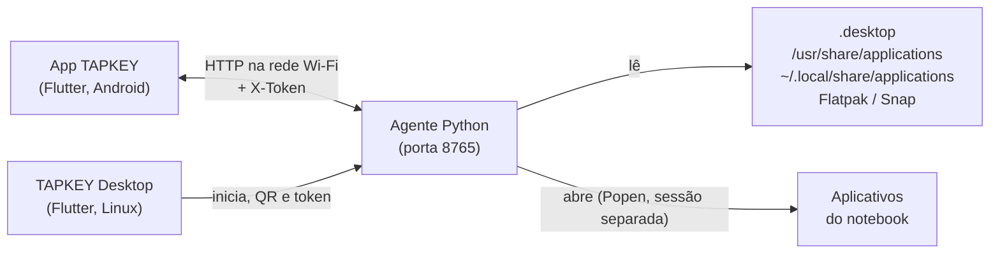

<div align="center">

# TAPKEY

### Seu notebook na palma da mão. Um toque, e abre.

Atalhos no celular que abrem aplicativos no seu notebook Linux, pelo Wi‑Fi, com animações fluidas e um mascote que reage a cada toque.

[](https://flutter.dev)
[](https://dart.dev)
[](https://www.python.org)
[](https://linuxmint.com)
[](#-instalação)
[](LICENSE)


</div>

<table align="center">
  <tr>
    <td align="center"><b>Retrato</b><br></td>
    <td align="center"><b>Paisagem (tela cheia)</b><br></td>
    <td align="center"><b>TAPKEY Desktop</b><br></td>
  </tr>
</table>

---

## Por que TAPKEY?

- **Zero atrito**: o app do celular lista os programas instalados no notebook; você escolhe os favoritos e toca para abrir.
- **Sem nuvem**: tudo roda na sua rede local. Nenhum servidor de terceiros, nenhuma conta.
- **Seguro por padrão**: o notebook só abre aplicativos da lista de `.desktop`, nunca comandos arbitrários, e exige um token.
- **Leve**: agente em Python com biblioteca padrão e um app desktop compacto na bandeja.
- **Com personalidade**: tema escuro minimalista, animações em mola e um mascote que acompanha o seu dedo.

## Destaques

| | |
|---|---|
| **Grade de favoritos** | Cartões quadrados com ícone real do aplicativo; toque longo para reordenar ou remover |
| **Lista do notebook** | O agente lê os `.desktop` (sistema, usuário, Flatpak e Snap) e envia nome e ícone |
| **Pareamento por QR** | Escaneie o QR do TAPKEY Desktop; IP, porta e token são preenchidos sozinhos |
| **Paisagem em tela cheia** | Grade ocupa toda a tela, cartões sempre quadrados e responsivos |
| **Tema minimalista** | Grafite com um único acento prata, brilho sutil só no acento |
| **Mascote animado** | Desenhado em código (`CustomPainter`), personagem original |
| **TAPKEY Desktop** | App do notebook com status, QR, token, bandeja e início com o sistema |

### O mascote

Um pequeno "squircle" com dois olhos grandes, feito só com `CustomPainter` e molas (sem imagens nem Lottie):

- respira e pisca de tempos em tempos;
- as pupilas seguem o último toque na tela;
- entra com um pulo e acena ao abrir o app;
- se amassa e fica emburrado quando você toca nele; três toques rápidos o deixam tonto (olhos em espiral);
- dá um pulinho feliz quando um atalho abre com sucesso;
- fica preocupado quando o notebook está desconectado.

## Início rápido (3 passos)

1. **Instale o TAPKEY Desktop** no notebook:
   ```bash
   curl -fsSL https://raw.githubusercontent.com/heliorosadoneto/TAPKEY/main/install.sh | bash
   ```
2. **Abra o TAPKEY Desktop**: ele liga o agente e mostra um QR.
3. **No celular**, abra o app TAPKEY, vá em *Configurações > Escanear QR* e adicione seus atalhos.

## Como funciona



1. O agente escaneia os arquivos `.desktop` e publica a lista (`/apps`) com os ícones (`/icon/<id>`).
2. O app do celular guarda seus favoritos localmente.
3. Ao tocar em um cartão, o app envia `POST /launch {id}` e o agente abre o programa correspondente.

## Requisitos

| Lado | Requisitos |
|---|---|
| Notebook | Linux Mint/Ubuntu (ou Debian), `python3`, sessão gráfica (X11/Wayland), mesma rede Wi‑Fi do celular |
| Celular | Android 7+ (testado no Android 11) |
| Desenvolvimento | Flutter 3.x com suporte a Linux desktop, `adb`, `dpkg-deb`, ImageMagick (`convert`) |

## Instalação

### Notebook: TAPKEY Desktop (recomendado)

```bash
curl -fsSL https://raw.githubusercontent.com/heliorosadoneto/TAPKEY/main/install.sh | bash
```

O script usa um `.deb` local, baixa o da última Release do GitHub ou compila a partir do código (se houver Flutter). Também dá para instalar o `.deb` manualmente:

```bash
sudo apt install ./tapkey-desktop_0.1.0_amd64.deb
```

O pacote instala o app em `/opt/tapkey-desktop`, o agente embutido, o atalho no menu (com ícone) e o comando `tapkey-desktop`.

<details>
<summary><b>Gerar o .deb você mesmo</b></summary>

```bash
git clone https://github.com/heliorosadoneto/TAPKEY.git && cd TAPKEY
flutter config --enable-linux-desktop
./packaging/build_deb.sh 0.1.0     # gera dist/tapkey-desktop_0.1.0_amd64.deb
```

Dependências de build: `cmake ninja clang pkg-config libgtk-3-dev libayatana-appindicator3-dev imagemagick`.
Os binários não são versionados; ficam em `dist/` (ignorado pelo git) e em *Releases*.
</details>

### Notebook: apenas o agente (sem interface)

```bash
cd agent
python3 agent.py                  # mostra IP, porta, token e o link de pareamento
./start.sh                        # reinicia em segundo plano
```

<details>
<summary><b>Iniciar o agente com o sistema (systemd de usuário)</b></summary>

```bash
mkdir -p ~/.config/systemd/user
cp agent/meu-notebook-agent.service ~/.config/systemd/user/
systemctl --user daemon-reload
systemctl --user enable --now meu-notebook-agent.service
```
Ajuste o caminho do `agent.py` no `.service` se o projeto estiver em outro lugar.
</details>

### Celular: app TAPKEY (Android)

```bash
git clone https://github.com/heliorosadoneto/TAPKEY.git && cd TAPKEY
flutter pub get

# (opcional) valores padrão de conexão; o arquivo é ignorado pelo git
cp config.local.example.json config.local.json

# depuração sem fio: Opções do desenvolvedor > Depuração sem fio > Parear
adb pair IP:PORTA
adb connect IP:PORTA
flutter devices
./run.sh -d <id-do-dispositivo>   # usa config.local.json se existir
```

Sem `config.local.json` o app compila normalmente; basta parear pelo QR ou digitar IP, porta e token em *Configurações*.

## Pareamento

1. Abra o **TAPKEY Desktop**. O QR contém `tapkey://pair?host=IP&port=8765&token=...`.
2. No app do celular: *Configurações > Escanear QR*.
3. O topo do app fica verde ("Conectado"). Para trocar de celular ou revogar acesso, use *Novo token* no desktop.

<details>
<summary><b>Pareamento manual</b></summary>

Digite em *Configurações* o IP do notebook, a porta (`8765`) e o token (mostrado no TAPKEY Desktop ou em `~/.config/tapkey/token`).
</details>

## API do agente

Todas as rotas exigem o cabeçalho `X-Token`.

| Método | Rota | Descrição |
|---|---|---|
| `GET` | `/ping` | Verifica se o agente está no ar |
| `GET` | `/apps` | Lista `[{id, name, icon}]` dos aplicativos instalados |
| `GET` | `/icon/<id>` | Ícone do aplicativo em PNG (404 se não houver) |
| `POST` | `/launch` | Abre o aplicativo: corpo `{"id": "firefox"}` |

```bash
curl -H "X-Token: $(cat ~/.config/tapkey/token)" http://IP:8765/apps
```

## Segurança

- **Token compartilhado** gerado na primeira execução, salvo em `~/.config/tapkey/token` (permissão 600) e exigido em toda requisição.
- **Somente aplicativos listados**: o agente só abre IDs encontrados nos `.desktop` escaneados; a linha `Exec` nunca vem do celular.
- **Rede local**: o tráfego é HTTP simples; use apenas em Wi‑Fi confiável. Com `ufw`, libere `8765/tcp` só para a sua rede.
- **Nada secreto no repositório**: IP e token reais ficam em `config.local.json` (ignorado pelo git).

## Estrutura do projeto

```text
TAPKEY/
├── lib/                    # app do celular (Flutter)
│   ├── screens/            # início, adicionar atalho, configurações, leitor de QR
│   ├── widgets/            # cartão animado, cabeçalho, mascote
│   ├── config.dart         # padrões de conexão (sem segredos)
│   └── state.dart          # favoritos, conexão e chamadas ao agente
├── desktop/                # TAPKEY Desktop (Flutter Linux)
├── agent/                  # agente Python (agent.py, start.sh, serviço systemd)
├── packaging/              # build_deb.sh, postinst, prerm, atalho .desktop
├── docs/                   # demo.gif e capturas de tela
├── install.sh              # instalação em uma linha
└── config.local.example.json
```

## Roadmap

- [x] Grade de favoritos, lista de apps do notebook e ícones
- [x] Paisagem em tela cheia e mascote animado
- [x] Pareamento por QR e TAPKEY Desktop com bandeja
- [ ] Vários notebooks (aba Dispositivos)
- [ ] HTTPS com certificado autoassinado
- [ ] Ações além de abrir apps (volume, mídia, bloquear tela)
- [ ] Pasta/grupos de atalhos e temas

## Licença

Distribuído sob a licença [MIT](LICENSE).

## Autor

**Hélio Rosado Neto**: [@heliorosadoneto](https://github.com/heliorosadoneto)
